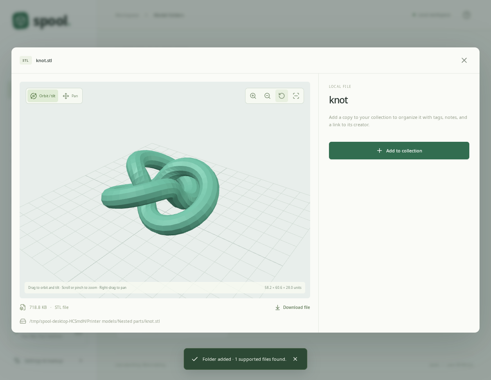

# Spool

A desktop app for browsing and cataloging 3D printing files. Add your model folders once, inspect files in 3D, and collect your favorites with their original ZIP and creator link.

Spool opens in its own window. **It does not start a webserver, listen on a localhost port, or need a browser.** Inspired by the browse-and-collect workflow in [Drape](https://github.com/anolis/drape).

[Project page](https://anolis.github.io/spool-3d-file-manager/) · [Download](https://github.com/anolis/spool-3d-file-manager/releases/latest) · [Issues](https://github.com/anolis/spool-3d-file-manager/issues)



## Install and open

Download the Linux AppImage or archive from [Releases](https://github.com/anolis/spool-3d-file-manager/releases/latest).

- **AppImage:** mark it executable in your file manager's Properties → Permissions, then open it. AppImage needs FUSE; if unavailable, run it with `--appimage-extract-and-run`, or use the archive.
- **Linux archive:** extract it and open the `spool` executable. Keep the other files in the extracted folder alongside it.

The packaged app includes its runtime; Node.js and npm are not needed to use it. Linux packages are currently provided for x86-64.

### Build from source

Requires Node.js 22.12+ (Node 24 recommended), npm, and a desktop session with WebGL support.

```sh
git clone https://github.com/anolis/spool-3d-file-manager.git
cd spool-3d-file-manager
npm install
npm start
```

`npm start` builds the interface and opens the desktop window directly. For a standalone app and Linux application-menu entry:

```sh
npm run desktop:dir
npm run install:desktop
```

Then open **Spool** from your applications menu. The installer copies the standalone app into your user data directory and registers its launcher without root. Repeating it updates the app; your collection lives separately and is preserved.

To create distributable AppImage and tar.gz packages, run `npm run package`.

## Model folders

Choose **Add folder** and select a folder with the system picker, or enter an absolute path. Spool remembers that folder and indexes STL, STEP/STP, 3MF, G-code, and ZIP files in its subfolders. It does not search your entire disk.

- Search all added folders together, or select a single folder.
- Files are previewed in place. Use **Add to collection** to make a catalog copy with editable metadata.
- Click **Rescan folders** after adding, moving, or removing files outside Spool.
- Removing a folder removes only its reference. Originals and catalog copies stay intact.
- Unavailable drives produce a clear error; reconnect the drive and rescan.
- Symlinks, hidden directories, node_modules, and Spool's own data directory are skipped. Each folder scan is capped at 50,000 supported files and reports when the limit is reached.

## Model details

Click a file to open its detail view. Visible controls let you:

- **Orbit / tilt:** drag to rotate around the model.
- **Pan:** select Pan and drag, or right-drag in either mode.
- **Zoom:** scroll, pinch, or use the zoom buttons.
- **Reset view:** fit and center the model again.
- **Wireframe:** inspect the mesh's edges.

STL and 3MF load as geometry; STEP/STP is converted locally using OpenCascade in a worker; G-code shows basic toolpaths. Source URLs, tags, notes, favorites, and printed status are editable for cataloged files. ZIP imports preserve the original archive and each model's relative path, with best-effort source-link detection from README/text/URL files.

## Actual combined search

Discover returns model cards **inside Spool**:

- **Printables:** live anonymous catalog search, with thumbnails and creators. No key needed.
- **Thingiverse, MakerWorld, MyMiniFactory, Cults3D:** actual indexed model results from Bing's RSS search feed, filtered to valid model URLs and labeled **Indexed**. Index coverage can be incomplete and can lag the source.
- **Optional direct APIs:** your own `THINGIVERSE_TOKEN` or `MYMINIFACTORY_KEY` enables live catalog search for those sources. Failed live requests fall back to indexed results with an error message.

Results are interleaved across sources, deduplicated, filterable by site, and can be saved for later. There are no search-page shortcuts standing in for results. Opening **View model** visits that model's creator page for details and downloads.

Public endpoints can change; Spool reports provider failures and retains results from working sources. Indexed results include Bing attribution and are rendered for personal use. API keys, if supplied, stay in the main process environment:

```sh
THINGIVERSE_TOKEN=your_token MYMINIFACTORY_KEY=your_key npm start
```

## Storage and backup

The desktop app stores its library under Electron's per-user app-data directory, independent of the checkout or installed executable. **Settings & backup** shows the exact location and can open it in your file manager. `SPOOL_DATA_DIR` overrides the catalog location; `SPOOL_USER_DATA` overrides the Electron profile location for testing.

The first source-checkout launch copies an existing `.local-data/` prototype collection into the desktop library if no desktop catalog exists. The old directory is left untouched. A packaged install can restore that collection using a previously exported backup.

**Export collection** opens a native Save dialog and includes catalog files, original ZIPs, metadata, and registered folder paths. Restore merges by ID; registered folders are reindexed on first access. Discover's saved links live in the app profile separately from this backup.

Removing a model hides it from the catalog; stored bytes remain to avoid accidental data loss. Original model-folder files are never changed or deleted.

## Limits

Imports and previews are limited to 300 MB per file. ZIP imports reject archives expanding beyond 600 MB; nested ZIPs are not expanded. Backup export builds an archive in memory, and backup restore has a 300 MB input limit. Very large or unusual STEP/3MF files may fail to preview; cataloging and download remain available. G-code preview is not a printer simulator. STL, 3MF, and G-code dimensions are shown in file units, usually millimeters.

The UI uses a sandboxed Electron renderer, context isolation, and a private `spool://` protocol for local assets and file operations. External model pages open in your system browser. The optional `npm run dev` Vite server is for interface development only.

## Verification

```sh
npm test
npm run build
npm run test:desktop
npm run test:ui
```

Desktop tests launch Electron, use temporary libraries and synthetic files, and verify native folder selection, recursive indexing, pan/tilt/zoom, backups, persistence, rescanning, safe removal, and STEP conversion. Set `SPOOL_LIVE_TEST=1` to include a real online search, or `SPOOL_TEST_EXECUTABLE` to test a standalone packaged executable.

Browser regression tests use Chrome; set `CHROME_PATH` if it is not `/usr/bin/google-chrome`. All model folders in tests are temporary, and actual user libraries are never used.

## License

Spool source is MIT licensed. OpenCascade and occt-import-js retain LGPL-2.1; their notices are in `public/occt/`. See [third-party notices](THIRD_PARTY.md). User models and creator content retain their original licenses.
